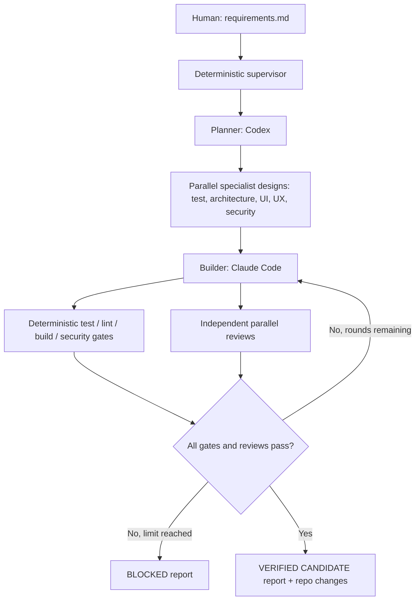

# Dual-Provider Autonomous Software Factory

**One requirements input in → verified local code candidate or blocked report out.** An independent Python supervisor orchestrates Codex and Claude Code as subprocesses. No dependency on a proprietary orchestration framework.

The default routing is Codex Planner → specialist design agents → Claude Builder → deterministic gates + independent Codex/Claude reviewers → Claude Builder repair → repeat. Providers can be swapped role-by-role in `factory.config.json`. Reviewers never author code.

> **Security boundary**: this scaffold is a working local supervisor, **not a production-grade, fully isolated execution service**. It does **not** merge, deploy, provision infrastructure, manage real secrets, or approve high-risk changes. It can optionally push a verified branch and open a GitHub pull request when the operator explicitly passes `--publish-pr`. For unattended runs, use a fresh ephemeral container or VM, a non-production data set, outbound network restrictions, and minimal credentials. An `auto` permission classifier or sandbox CLI option is not a substitute for VM/container isolation.

## Architecture



### Responsibility matrix

| Agent | Before build | After build | May edit code? |
|---|---|---|---|
| Planner | Scope, dependencies, acceptance criteria, UI classification | — | No |
| Builder | Implement, write tests, integrate | Fix blocking findings | **Yes** |
| Testing | Test matrix and verification cases | Coverage/gap review | No |
| Architecture | Contracts, boundaries, operability | Compatibility, maintainability review | No |
| UI | Visual specification, responsive states | Visual/DOM/accessibility review | No |
| UX | User journeys, usability and accessibility criteria | Task-flow/error-recovery review | No |
| Security | Threat model, misuse cases, safeguards | Independent security review | No |

For non-UI changes, the supervisor skips UI and UX specialists. Test, architecture and security reviews always run. Gate commands are **actual executable processes**; model opinions never replace them.

## Install and run

### 1. Prepare a disposable working copy

From the extracted playbook directory, install into the *root of the target Git repository* with:

```bash
python install.py /path/to/your/repository
```

The installer refuses to overwrite unrelated existing files. It merges guidance into existing `AGENTS.md`, `CLAUDE.md` and `.gitignore` rather than overwriting them. Review the installed changes, then `git add` and commit them on a disposable working branch. Use a dedicated clone or worktree with no production credentials, and ensure the working tree is clean before starting.

Requirements:

- Python 3.10+; Git; Codex CLI installed and authenticated, and/or Claude Code CLI installed and authenticated.
- For Claude `--bare` runs, set `ANTHROPIC_API_KEY` (the CLI intentionally does not use subscriber credentials in bare mode). Choose only Codex providers to avoid needing this key, or configure roles to only Claude if you prefer.
- Codex CLI configured to authenticate and run `codex exec` in that environment.
- Install your project stack and test/security tooling in advance. CLI and dependencies must be available on `PATH`.

### 2. Configure gates (mandatory)

Edit `factory.config.json`: **every `required_gates` item must have at least one argv command array**. Start from `examples/config-node.json` or `examples/config-python.json` *as a reference*, then adapt to your repo. These are illustrations, not guaranteed commands for your stack.

Example:

```json
"commands": {
  "tests": [["npm", "run", "test:ci"]],
  "lint": [["npm", "run", "lint"]],
  "security": [["npm", "audit", "--audit-level=high"]],
  "build": [["npm", "run", "build"]],
  "ui_e2e": [["npx", "playwright", "test"]]
}
```

Do not add placeholder commands that always exit 0. For UI work, `ui_e2e` is mandatory: configure browser tests, accessibility checks and screenshot or visual comparison evidence. The UI reviewer should fail if it cannot inspect actual rendered evidence; Playwright passing without suitable screenshots does not by itself prove visual quality. Consider screenshot output under a known folder the reviewer can read.

Gate commands execute directly from argv with no shell or `sh -c`. Gate processes can run untrusted code from the repository; **run inside isolation**, and do not give them production credentials. Configure appropriate per-gate timeouts.

### 3. Supply a single spec

Either write a spec such as `specs/my-feature.md` (see `specs/example.md`), **or provide a one-line request with `--idea`**. State the user outcome, behavior, constraints and non-goals. A file-based spec should be committed first so the initial worktree is clean.

### 4. Preflight and run

```bash
python factory.py --idea "Add an accessible task list with tests" --dry-run
python factory.py --idea "Add an accessible task list with tests"
# Or: python factory.py specs/my-feature.md
```

Results are written to `.factory/runs/YYYYMMDDTHHMMSSZ/` (ignored by Git): plan, specialist design outputs, build result, gate logs, independent reviewer JSON, repair attempts and `DELIVERY.json`.

The final status is:
- `verified_candidate`: every required executable gate passed and each required independent specialist returned an acceptable review, with no unresolved Builder items. The code is changed locally but **not merged or deployed**; it is only pushed when `--publish-pr` is explicitly enabled.
- `blocked`: an actual gate or review failed, a required tool could not run, design had a blocker, a protected file changed, or the repair budget was exhausted. Exit status 2.

The final result is evidence-bounded: passing configured checks does not guarantee production safety or absence of bugs.

## Provider routing and cost

`factory.config.json` controls **each role**. Example defaults: Codex on planning/testing/security/UI, Claude Code on implementation/architecture/UX. For cross-provider review diversity, avoid letting Builder review its own changes. A role set to `codex` accepts a CLI model override or `null` for the configured default; Claude roles accept aliases like `sonnet` or `opus`.

`claude_budget_usd_per_call` limits *each Claude CLI invocation*, not the entire factory. The supervisor limits to `max_review_rounds` review passes and enforces subprocess timeouts; it does not yet implement an aggregate dollar budget for Codex or Claude. Implement an external spend watchdog before using this for large-scale continuous tasks.

## Important limitations and extension points

- **PR publication opt-in.** A `--publish-pr --base main` run creates a dedicated branch, commits the verified changes, pushes to `origin`, and invokes `gh pr create`. This requires `gh` authenticated and a clean tree. No auto-merge, deployment, environment creation, secret provisioning, or rollback is implemented. Enable GitHub branch protection and CI on the *target* repo.
- **Not a hermetic runner.** The harness checks that Git HEAD and protected policy/config/role files have not changed. It cannot protect against malicious code running with the same OS privileges; use containerization, egress controls, host-level permissions and secrets isolation.
- **Visual review requires actual visual evidence.** UI/UX reviewer judgment from source is limited; add Playwright screenshot capture, browser accessibility audits and visual diffs in your repo, or keep release blocked.
- **Manual test and threat model review remain useful** for high-impact changes; automatic checks can miss novel vulnerabilities and real user behavior.
- **No native Codex/Claude subagent dependency.** Native Claude subagents in `.claude/agents` and the Codex `.agents/skills/software-factory` entry are provided for interactive reuse. The *supervisor* invokes isolated CLI processes and owns sequencing, retries and release decisions. No reliance on an agent promising to summon other agents.
- **Response logs and prompts** live locally in ignored `.factory/runs`; never commit or upload these directories without checking sensitivity.

## Technical references

- [Codex CLI command-line options](https://learn.chatgpt.com/docs/cli/reference)
- [OpenAI Codex iterative repair loops cookbook](https://developers.openai.com/cookbook/examples/codex/build_iterative_repair_loops_with_codex)
- [Claude Code CLI reference](https://code.claude.com/docs/en/cli-reference)
- [Claude Code non-interactive execution and structured output](https://code.claude.com/docs/en/headless)
- [Claude Code subagents](https://code.claude.com/docs/en/sub-agents)
- [OpenAI sandbox security guidance](https://developers.openai.com/api/docs/guides/agents-api/environments/security)

## Verify the supervisor independently

Run `python -m unittest discover -s tests -v` to exercise decision gates, JSON result validation, and an end-to-end *mock* Codex workflow (no model calls). This does not substitute for a real CLI integration test in your environment.

## Opt-in third-party role skills

After installing the factory files into a target repo, review [requested skills](docs/REQUESTED_SKILLS.md), run `python skillctl.py list`, `python skillctl.py install`, `python skillctl.py validate`, commit the generated `skills/lock.json`, then enable `skills.enabled` in `factory.config.json` and commit config changes. This installs prompt-instruction packages only; Screenshot-to-Code and Graphify graph generation require separate future integrations.

## Required model split (v0.4)

The example config chooses `gpt-6-sol` for planner, `claude-opus-5-5` for Build Orchestrator, and `gpt-6-luna` / `claude-haiku-5-5` for all specialists and the Build Worker. These are explicit CLI model IDs, not descriptive labels.

A supported alternate high-tier OpenAI model is `gpt-6.1-sol` where available. Allowed Opus versions and Haiku versions are defined in `factory.ALLOWED_MODELS`. If a model is unavailable to your authenticated CLI, change that role to another approved **same-tier** model; the supervisor must never silently upgrade a cheap worker or downgrade a planning orchestrator.

The `builder` role is the implementation worker. `build_orchestrator` is a new separate read-only coordination role. It decides dispatch and repair strategy, not code.

Run `python factory.py --idea "small change" --dry-run` after configuring real gates. This validates the role/model policy without making a model request; it does **not** prove your account has access to a chosen model.
