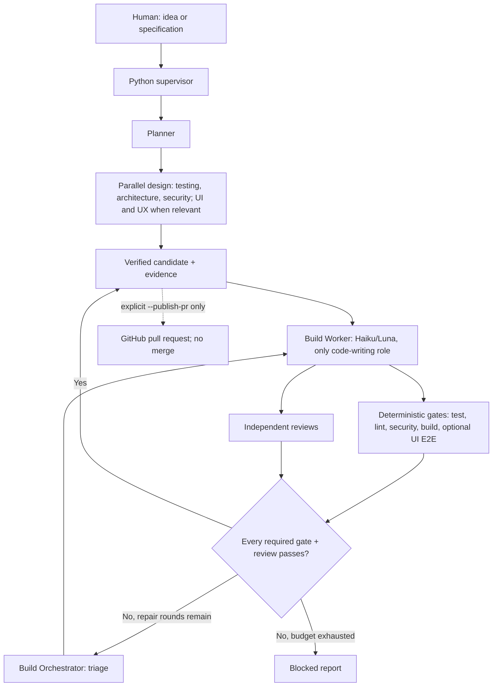

# Agentic Software Factory

**A provider-neutral, independently verified software development loop for Codex and Claude Code.**

 

> Status: **v0.4 adversarially reviewed reference implementation**, locally mock-tested. The actual Codex/Claude integrations have **not** been live-tested in the supplied environment. This is not a production-secure execution sandbox.

Human describes the outcome once; a deterministic supervisor uses premium planning and build orchestration, routes low-cost specialist design work, implements, runs executable checks, asks independent reviewers, repairs issues, and returns a verified candidate **or a blocked report**. A verified result means only that configured gates and reviewers passed, not that the software is defect-free.



## Quick start

**Requirements:** Python 3.10+, Git, at least one authenticated coding CLI (`codex`, `claude`), and installed project-specific verification tools. When using Claude in `--bare` mode, use an Anthropic API key or a supported enterprise provider credential, rather than assuming subscription login works. Use an **ephemeral VM/container without production credentials** for unattended workloads.

1. Clone this repository and install its playbook into the **target application repository**:

   ```bash
   python install.py /path/to/application-repository
   ```

2. In the application repository, edit `factory.config.json` to set each role's provider and **real executable gate commands**; examples are in `examples/config-node.json` and `examples/config-python.json`. The unconfigured template deliberately refuses to run. Commit installation changes, leaving the working tree clean.

3. Provide the feature request once, then let the supervisor operate:

   ```bash
   python factory.py --idea "Create an accessible settings page with validation and tests" --dry-run
   python factory.py --idea "Create an accessible settings page with validation and tests"
   # Alternative input: python factory.py specs/my-feature.md
   ```

4. Inspect `.factory/runs/<timestamp>/DELIVERY.json` and the local source diff. `verified_candidate` is a success for configured checks; `blocked` requires intervention or another run. When you intentionally want a **PR as the final human-facing artifact**, use the opt-in path below.

### Optional GitHub PR output

On a clean clone of an application repo with `origin`, an authenticated `gh` CLI, and local `main` branch:

```bash
python factory.py --idea "Create a searchable dashboard" --publish-pr --base main
```

Only after verification succeeds, the supervisor commits, pushes a `factory/*` branch, and creates a PR. It does **not** auto-merge or deploy. Configure GitHub branch protection and CI as separate controls. Because generated code can be malicious, execute in an isolated environment with a narrowly scoped GitHub credential, and inspect the PR before merge. The integrated automated publication is optional and has not been smoke-tested against a real GitHub remote.

## Pinned skills (v0.3)

A role/phase skill registry now includes UI UX Pro Max, Emil Kowalski design-engineering skills, Ponytail, Graphify guidance, and a foundational-loop shortlist from alirezarezvani/claude-skills. Screenshot-to-Code is registered as an **optional external application**, not a fake SKILL.md integration. **Live Screenshot-to-Code and Graphify graph-generation adapters are not included.**

Skill activation is opt-in because the shipped project intentionally does not automatically download or execute third-party code. Run `python skillctl.py list`, then `python skillctl.py install` inside the installed application repository. Audit staged assets, commit `skills/lock.json`, set `skills.enabled=true` in `factory.config.json`, and commit the changes. This loads selected pinned skill instructions into either CLI prompt, including Claude `--bare`. Running with enabled skills and a missing/modified selection fails closed.

See [new assignments](docs/REQUESTED_SKILLS.md) and [foundational loop scan](docs/FOUNDATIONAL_LOOP_SKILL_SCAN.md) for sources, conditions, limitations and next integration steps.

## Agent roles

| Role | Provider default | Responsibility | Repo writes? |
|---|---|---|---|
| Planner | Codex Sol | Product outcome, acceptance criteria, decomposed tasks, UI classification | No |
| Architecture | Claude Haiku | Contracts, boundaries, migrations, operations | No |
| Testing | Codex Luna | Test design, assertions and coverage review | No |
| UI | Codex Luna | Visual/component standards and rendered-evidence review | No |
| UX | Claude Haiku | User journeys, accessibility and recovery flows | No |
| Security | Codex Luna | Threat model, vulnerabilities and abuse paths | No |
| Build Orchestrator | Claude Opus | Implementation dispatch and review triage | No |
| Builder (worker) | Claude Haiku | Implementation, tests, repairs based on findings | **Yes** |

Configurable in `factory.config.json`: the entire pipeline can be Codex-only, Claude-only, or mixed. UI and UX specialists are invoked only when Planner classifies the work as UI-affecting. Design precedes Build; independent reviews run after every Build/repair iteration.

## Why an external supervisor?

An LLM's statement that tests passed is not evidence. `factory.py` owns routing, collects JSON-schema outputs, runs actual project checks as subprocesses, prevents modification of governance files, and enforces a hard maximum of repair rounds. A failed scanner, unavailable CLI, missing gate configuration or invalid review output **blocks delivery**.

No dependency on CrewAI, LangGraph, BMAD, Ralph, OpenHands, or another orchestrator is required. Inspirations are documented in [`docs/INSPIRATION.md`](docs/INSPIRATION.md); the implementation intentionally borrows *patterns*, not their code.

## What's included

- `factory.py` — supervisor; Codex/Claude CLI adapters, structured contracts, gates, repair loop, optional PR publication.
- `roles/` — provider-independent role playbooks; `.claude/agents/` — native interactive Claude agents; `.agents/skills/` — Codex-compatible skill.
- `POLICY.md`, `AGENTS.md`, `CLAUDE.md` — shared governance and usage instructions.
- `skillctl.py` and `skills/registry.json` — optional pinned third-party skill staging, selection and validation (no script execution).
- `install.py` — safely installs playbook files into an existing project without overwriting unrelated content.
- `factory.config.json` — mandatory per-role routing and quality gate configuration.
- `tests/` and `.github/workflows/ci.yml` — harness regression tests.
- `docs/` — architecture, inspirations, operating limits and repository publication.

## Safety and operational limits

- A **local supervisor is not a security sandbox**. Build agents and test commands execute locally. Treat all repositories and dependency install steps as untrusted code; use a fresh VM/container, egress restrictions and no production credentials.
- Read-only reviewer sessions cannot guarantee that external tools will never mutate files. Git policy-file hashes and HEAD checks detect some tampering; only OS-level isolation provides a meaningful security boundary.
- UI/UX review requires *actual* browser evidence (for example Playwright screenshots and accessibility results). A source review alone cannot verify appearance.
- This version does not support managed deployment, migrations against production, automatic rollback, aggregate hard-dollar cost accounting, or built-in remote job queues.
- Default `factory.config.json` **cannot run** until you supply real gates for your project's stack. Example gate commands are not universal.
- CLI adapters match the October 2026 documented interfaces; run a real integration smoke test with your installed CLI versions before trusting a long unattended run.

See [setup details](FACTORY_SETUP.md), [architecture](docs/ARCHITECTURE.md) and [publisher guide](docs/PUBLISH.md).

## Verify the harness

```bash
python -m unittest discover -s tests -v
python -m py_compile factory.py install.py skillctl.py
```

Tests mock the coding CLIs; they do not spend model tokens or validate model-generated software.

## License

MIT. See [LICENSE](LICENSE). This repository is an original reference implementation inspired by public projects; no third-party source code is bundled.

## Model tier enforcement (v0.4)

`factory.config.json` explicitly names all eight role models. Orchestrators `planner` and `build_orchestrator` use Opus or Sol. All specialist roles AND `builder` (the code-writing worker) use Haiku or Luna. No implicit/default model and no automatic premium fallback. When model access fails, the run blocks rather than violating its tier. See `docs/ADVERSARIAL_AUDIT_V04.md`.

## Adversarial validation and residual risk

Version 0.4 has 30 local unit/mock integration tests, including unauthorized model routing attempts, source mutation detection, verification-entrypoint weakening, explicit provider CLI model flags, and a two-round mock repair. See [the audit](docs/ADVERSARIAL_AUDIT_V04.md). Model routing applies to **supervisor-created CLI calls**; running nested agents from arbitrary shell commands is not technically prevented without host-level isolation/provider access controls. Live Claude/Codex invocations, immutable remote CI and container enforcement remain outside this reference implementation.
